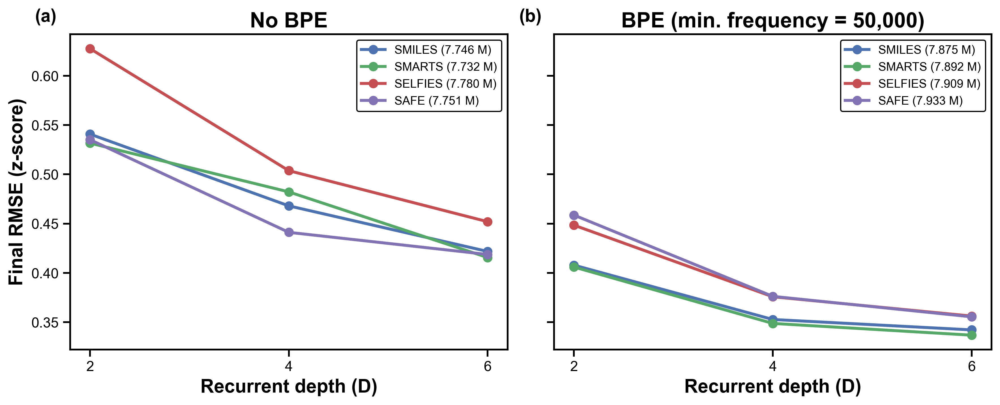

# SimPro-ValueNetwork

The project is **SimPro-ValueNetwork**. Its distribution and Python import name is `simpro_vn`; console entrypoints are `simpro-vn` and `simpro-vn-train`. pip may display the normalized distribution name `simpro-vn`; it refers to the same package.

Use pretrained value networks to predict 17 complete-molecule physicochemical properties from complete molecular strings or incomplete prefixes. Models support SMILES, SMARTS, SAFE, and SELFIES, with batch prediction and incremental KV-cache inference.

To use the models, install the package, obtain the selected checkpoint, and run inference. Data preparation, training, and fine-tuning are optional learning examples.

## Research Results

Final z-score RMSE decreases with recurrent depth across the four representations. Reusing a shared Transformer block keeps parameter counts unchanged across depths within each setting.



See [Research Results](docs/RESEARCH_RESULTS.md) for additional figures. Prediction does not require the analysis dataset or inference cache.

## Installation

### Download v0.1.0

Get the source and pretrained checkpoints from the [v0.1.0 release](https://github.com/ycliu0214/SimPro-ValueNetwork/releases/tag/v0.1.0).

| Download | Contents |
| --- | --- |
| [Source package](https://github.com/ycliu0214/SimPro-ValueNetwork/releases/download/v0.1.0/SimPro-ValueNetwork-source.zip) | Source code, preprocessing assets, configurations, tests, documentation, and notebooks; no checkpoint binaries |
| [SMILES weights](https://github.com/ycliu0214/SimPro-ValueNetwork/releases/download/v0.1.0/SimPro-ValueNetwork-smiles-weights.zip) | 15 SMILES checkpoints |
| [SMARTS weights](https://github.com/ycliu0214/SimPro-ValueNetwork/releases/download/v0.1.0/SimPro-ValueNetwork-smarts-weights.zip) | 15 SMARTS checkpoints |
| [SAFE weights](https://github.com/ycliu0214/SimPro-ValueNetwork/releases/download/v0.1.0/SimPro-ValueNetwork-safe-weights.zip) | 15 SAFE checkpoints |
| [SELFIES weights](https://github.com/ycliu0214/SimPro-ValueNetwork/releases/download/v0.1.0/SimPro-ValueNetwork-selfies-weights.zip) | 15 SELFIES checkpoints |
| [SHA256 checksums](https://github.com/ycliu0214/SimPro-ValueNetwork/releases/download/v0.1.0/SHA256SUMS.txt) | Checksums for the source ZIP and four weight ZIPs |

Extract the source package first, then extract the selected weight archive into the project root containing `pyproject.toml`. Weight archives retain `weights/<representation>/` paths. Download all four for comprehensive validation; ordinary inference only requires the selected checkpoint. Compare downloaded archive hashes against SHA256SUMS.txt.

If the repository is private, release downloads require a GitHub account with access.

### Install the Package

Python 3.10 or newer is required. Use the first command for basic inference and the chemistry extra for SAFE/SELFIES.

```bash
pip install .
pip install ".[chemistry]"
```

Core dependencies are PyTorch and tokenizers. `device="auto"` uses CUDA when available, otherwise CPU.

Model binaries are distributed separately from source code. Obtain the selected checkpoint and retain the matching representation, tokenization setting, and depth. See [Model Catalog](docs/MODEL_CATALOG.md) and [Weights](weights/README.md).

## Colab

For complete checks, open [Comprehensive Colab Validation](examples/colab_comprehensive_validation.ipynb), set `PROJECT_DIR` and `WEIGHTS_DIR`, and run all cells in order. It covers normal/wheel installation, functional tests, all 60 models through CLI/API, data preparation, scratch training, released-model fine-tuning/resume, and original-weight preservation. See [Comprehensive Validation](docs/COMPREHENSIVE_VALIDATION.md) for scope and reports.

Extract the project to `/content/SimPro-ValueNetwork`, open [the inference example](examples/colab_inference.ipynb), and run cells in order. For other locations, set `PROJECT_DIR` to the root containing `pyproject.toml`. Select checkpoints separately with `WEIGHTS_DIR` or `CHECKPOINT_PATH`.

```python
from pathlib import Path
PROJECT_DIR = Path('/content/SimPro-ValueNetwork')
assert (PROJECT_DIR / 'pyproject.toml').is_file()
%pip install "{PROJECT_DIR}[chemistry]"
```

Google Drive is optional. If using Drive, set `USE_GOOGLE_DRIVE=True` in the notebook, mount it, and set `PROJECT_DIR` to your own location. Pretrained inference requires neither a training CSV nor a training notebook.

## Python API

```python
from simpro_vn import ValueNetworkPredictor

predictor = ValueNetworkPredictor(
    checkpoint_path="weights/smiles/value_network_best_smiles_bpe_min_freq_5000_d6.pt",
    representation="smiles",
    min_frequency=5000,
    depth=6,
    device="auto",
)

predictions = predictor.predict(["CCO", "c1ccccc1"], batch_size=32)
prefix_prediction = predictor.predict("CC", complete=False)
trajectory = predictor.predict_trajectory("CCO")
print(predictions[0])
```

`predict()` returns `list[dict[str, float]]` in input order, restored to property units. Complete strings are read at EOS. `complete=False` omits EOS; an empty prefix contains BOS only.

Inputs must already use the selected representation. Token coverage is not chemical validation. Text prefixes must end at recognizable token boundaries. Length limits include BOS/EOS; oversized inputs raise an error without truncation.

## Models and Preprocessing Assets

Each representation has five tokenization settings at depths 2/4/6, for 60 models. Select No BPE with the string `"no_bpe"`.

| Representation | Settings | Depths |
| --- | --- | --- |
| SMILES | 5000, 10000, 20000, 50000, no_bpe | 2, 4, 6 |
| SMARTS | 5000, 10000, 20000, 50000, no_bpe | 2, 4, 6 |
| SAFE | 5000, 10000, 20000, 50000, no_bpe | 2, 4, 6 |
| SELFIES | 5000, 10000, 20000, 50000, no_bpe | 2, 4, 6 |

```python
predictor = ValueNetworkPredictor.from_config("configs/selfies_50000_d6.json")
predictions = predictor.predict("[C][C][O]")
```

Config-relative paths resolve from the JSON directory; constructor-relative paths resolve from the working directory. Checkpoints may be stored anywhere readable.

Replacing tokenizer/mapping or refitting the scaler is unsupported. Custom `tokenizer_prefix` and `scaler_path` must point to content-equivalent copies of the selected bundle; loading compares JSON contents. A tokenizer prefix excludes the `_tokenizer.json` and `_mapping.json` suffixes.

Published checkpoints are matched by SHA256 to verify depth, representation, and preprocessing, independently of filename. `predictor.describe()` reports dimensions, property order, and verification level. Existing weight files are unchanged.

## PyTorch Tensor Interfaces

```python
import torch

values = predictor.predict_tensor(["[C][C][O]"])  # [N, 17], on predictor.device
ids = torch.tensor([predictor.encode("[C][C][O]")])
values_from_ids = predictor.predict_ids(ids)
```

This example uses the SELFIES predictor above. Text must match the selected representation. Tensor methods retain the selected device, default to property units, and accept standardized=True for z-scores without tracking Value Network gradients. Sessions also expose step_tensor(). See [MODEL_INTERFACE.md](docs/MODEL_INTERFACE.md) for the full contract.

## KV-cache

```python
session = predictor.new_session()
for token_id in predictor.encode("[C][C][O]"):
    current_prediction = session.step(token_id)[-1]
session.reset()
```

Each session handles one sequence beginning with BOS. Supply one or multiple token IDs and reset after EOS. The generator must use the same tokenizer. Independently BPE-encoding arbitrary text chunks can change cross-boundary merges.

## Command Line

```bash
simpro-vn --checkpoint weights/smiles/value_network_best_smiles_bpe_min_freq_5000_d6.pt --text "CCO"
simpro-vn --checkpoint /path/to/model.pt --text "CC" --prefix
simpro-vn --checkpoint /path/to/model.pt --input-file molecules.txt --output predictions.json
simpro-vn --checkpoint /path/to/no_bpe_model.pt --min-frequency no_bpe --depth 6 --text "CCO"
simpro-vn --help
```

Input files contain one string per line. Repeat `--text` for multiple inputs; `--trajectory` returns per-token predictions. Other options include `--representation`, `--depth`, `--batch-size`, `--device`, `--tokenizer-prefix`, and `--scaler`. `python -m simpro_vn` is also supported.

## Optional Learning Examples

To learn how training works or fine-tune on your own data, see [fine-tuning](examples/colab_finetuning.ipynb), [three-stage training](examples/colab_training.ipynb), and [data preparation](docs/DATA_PREPARATION.md). These examples are optional for inference users.

Examples use the [300-row smoke dataset](examples/data/README.md), retain fixed preprocessing assets, and save results in new directories; initialization weights are read-only. See [Training](docs/TRAINING.md) for settings, formulas, and resuming, and [Training Validation](docs/TRAINING_VALIDATION.md) for checks.

## Examples and Documentation

| File | Purpose |
| --- | --- |
| [colab_comprehensive_validation.ipynb](examples/colab_comprehensive_validation.ipynb) | One-run CLI/Python, installation, inference, data, and training checks |
| [COMPREHENSIVE_VALIDATION.md](docs/COMPREHENSIVE_VALIDATION.md) | Complete validation steps, scope, and result interpretation |
| [colab_inference.ipynb](examples/colab_inference.ipynb) | Prediction and KV-cache |
| [MODEL_INTERFACE.md](docs/MODEL_INTERFACE.md) | Model descriptions and tensor contracts |
| [PACKAGE_VALIDATION.md](docs/PACKAGE_VALIDATION.md) | Installation/interface validation |
| [prepare_finetuning_dataset.ipynb](examples/prepare_finetuning_dataset.ipynb) | SMILES, optimization, labels, compatibility |
| [colab_finetuning.ipynb](examples/colab_finetuning.ipynb) | CLI/API fine-tuning, saving, reload, resume |
| [colab_training.ipynb](examples/colab_training.ipynb) | Scratch and three-stage training |
| [TRAINING.md](docs/TRAINING.md) | Training settings, loss, checkpoints |
| [TRAINING_VALIDATION.md](docs/TRAINING_VALIDATION.md) | Test commands and coverage |
| [PROPERTIES.md](docs/PROPERTIES.md) | Property definitions and units |
| [DATA_PREPARATION.md](docs/DATA_PREPARATION.md) | User-data preparation |
| [REPRODUCING_RESULTS.md](docs/REPRODUCING_RESULTS.md) | Inputs for analysis figures |
| [VALIDATION_RESULTS.md](docs/VALIDATION_RESULTS.md) | Recorded Colab functional validation results |
| [PUBLISHING.md](docs/PUBLISHING.md) | Source repository contents and separate release assets |

Comprehensive validation uses `colab_validation.py`, `validate_installation.py`, `run_validation_tests.py`, `finetuning_data.py`, and `tests/`; upload the complete source project and the 60 released checkpoints. Reports go to new subdirectories under `validation_runs/`. Checks establish functionality and numerical consistency, not prediction accuracy. Public notebooks have execution outputs and runtime metadata cleared; recorded results are summarized in [Validation Results](docs/VALIDATION_RESULTS.md).

Data preparation requires `pip install ".[data]"` and `finetuning_data.py`. Every retained molecule undergoes CPU MMFF94 optimization before 17-label calculation and fixed-bundle checks. Pass the exported CSV to the fine-tuning example; ordinary prediction does not need preparation dependencies.

## License and Third-Party Software

Original project source code, documentation, and configuration are licensed under [Apache-2.0](LICENSE). Separately installed dependencies retain their own licenses. The included SAFE converter adaptation is attributed in [NOTICE](NOTICE); dependency licenses, data considerations, and model-release scope are described in [THIRD_PARTY_NOTICES.md](THIRD_PARTY_NOTICES.md).

The 60 pretrained checkpoints listed in `weights/manifest.json` are also licensed under Apache-2.0; see [Pretrained Checkpoint License](weights/WEIGHTS_LICENSE.md). Their release archives include the license, applicable notices, model descriptions, and SHA256 checksums. Upstream datasets and the processed CSV sample remain separate from this code/checkpoint grant.

## Acknowledgments

This work was supported by the Ministry of Science and Technology (MOST) under grant `MOST 113-2113-M-A49-027-` and the National Science and Technology Council (NSTC) under grant `NSTC 114-2113-M-A49-015-`.
