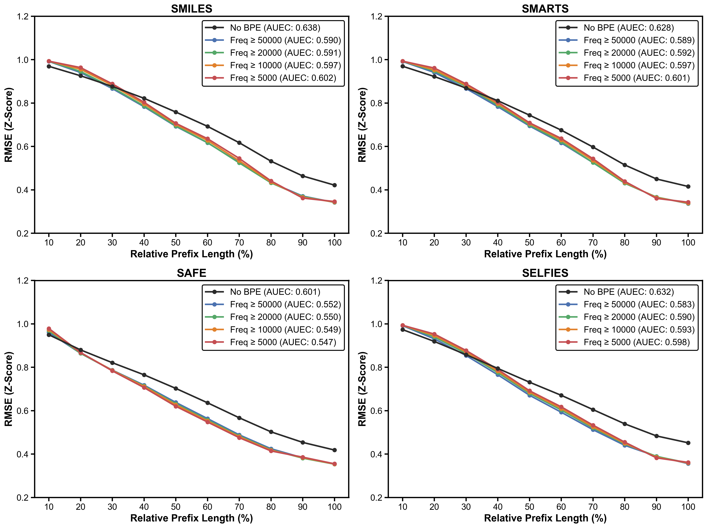
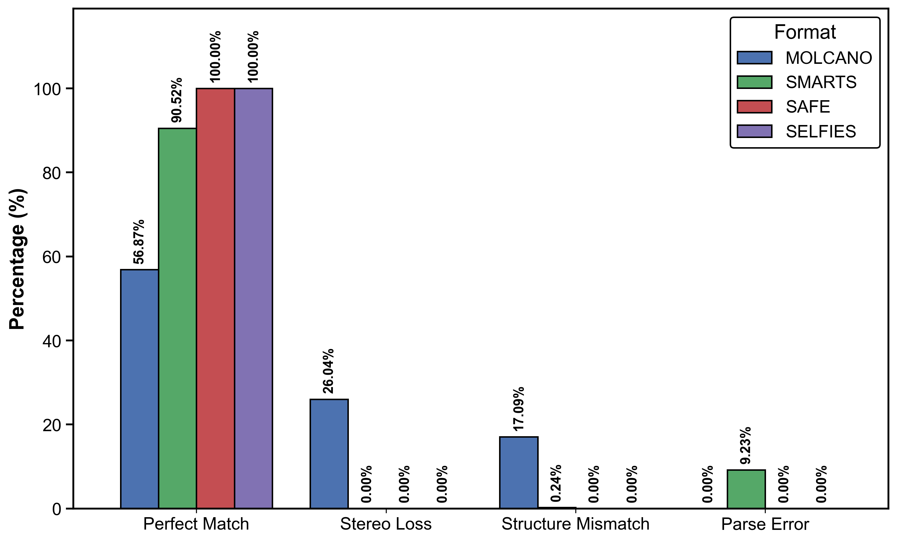
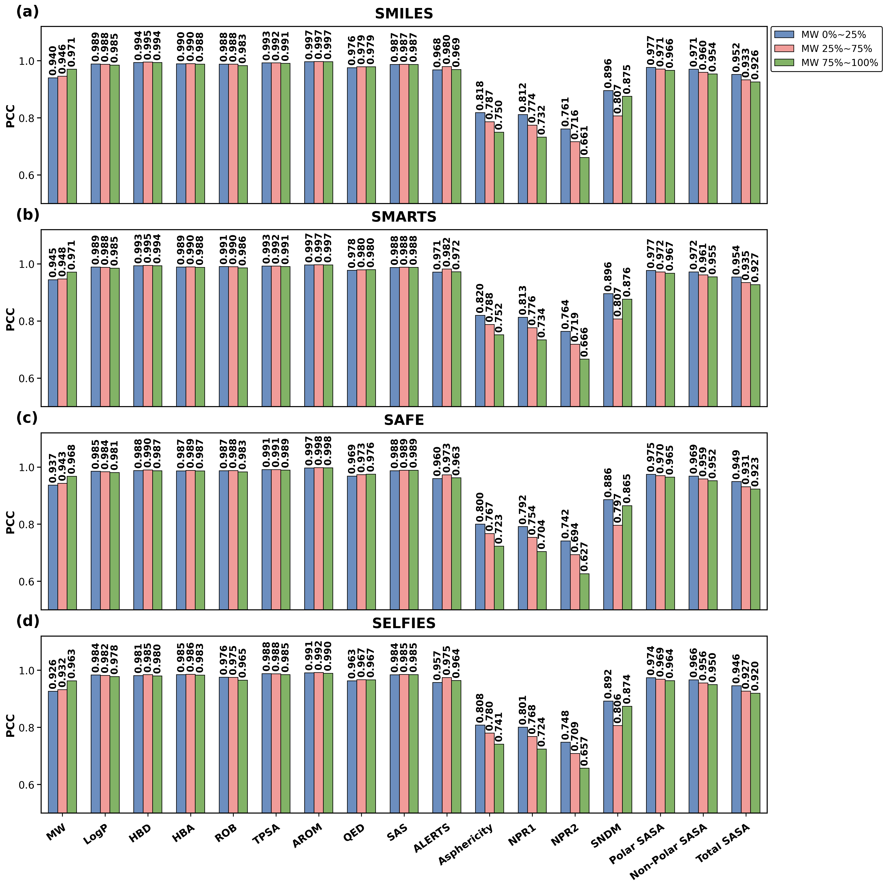

# Research Results

The model predicts 17 complete-molecule properties from molecular prefixes. The study uses 2,899,890 entries from ZINC250k and MOSES after stereo expansion, conformer optimization, representation screening, and deduplication.

## Recurrent Depth

Final z-score RMSE decreases with depths 2, 4, and 6 for all four representations. A shared Transformer block keeps parameter counts fixed within a representation/tokenization setting. Panels compare No BPE and minimum frequency 50,000.

## Prefixes and BPE

At depth 6, error decreases as more of the string becomes visible. BPE settings have lower AUEC than No BPE. AUEC measures error-curve area over 10%–100% relative prefix length; lower is better, and the best threshold can differ by representation.

## Representation Fidelity

Round-trip canonical SMILES comparisons classify Perfect Match, Stereo Loss, Structure Mismatch, and Parse Error. The comparison includes MOLCANO, which is not included among the prediction models.

## Molecular-Weight Strata

At BPE 50,000 and depth 6, property-wise PCC is compared across true-MW percentile groups. Stratified correlation describes performance by molecular-weight range rather than per-record prediction error.

Viewing figures and using pretrained models do not require the large analysis inputs. See [REPRODUCING_RESULTS.md](REPRODUCING_RESULTS.md) for analysis data requirements.

These figures describe the pretrained models, not performance after user-data fine-tuning. See [TRAINING.md](TRAINING.md) for training and fine-tuning; distinguish functional checks from prediction-accuracy evaluation.
